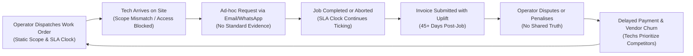
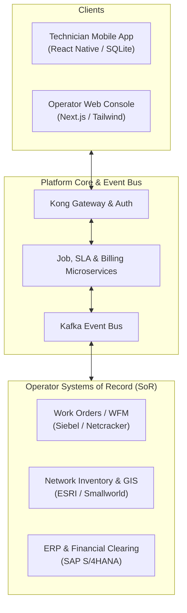
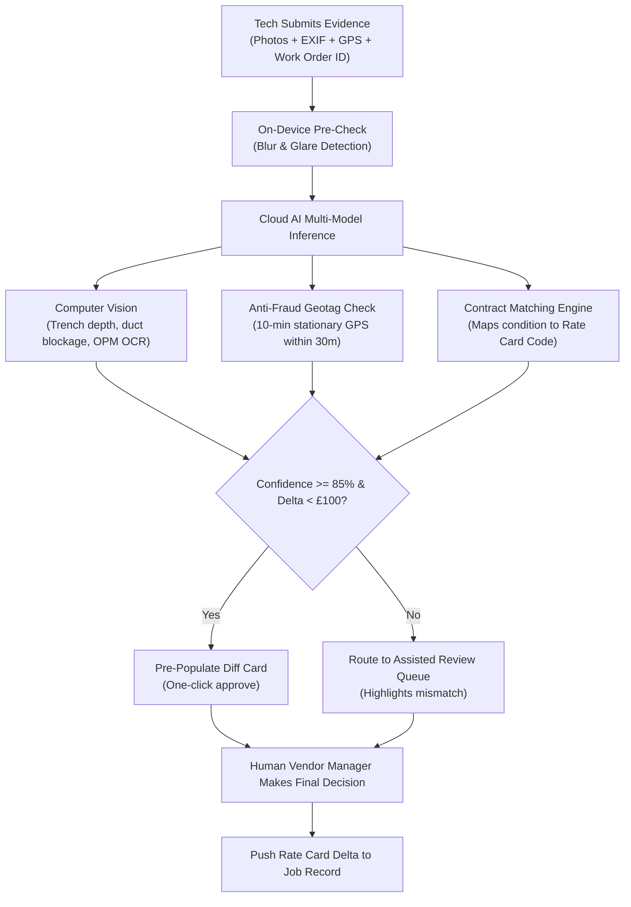
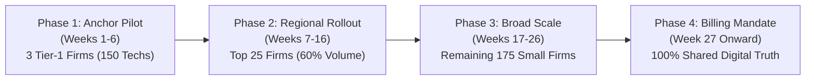

# Subcontractor Operations Platform for National Fiber Broadband Operator

[](./B2B_PM_Case_Study_Complete_Deliverable.md)
[](./wireframes.html)
[-amber.svg)](./presentation_deck.pptx)
[](#1-executive-summary--the-50m-blind-spot)
[](#6-business-model-unit-economics--286x-operator-roi)

> **Candidate Assignment Deliverable:** B2B Product Management Case Study  
> **Author:** Komal Agarwal  
> **Date:** November 2026  
> **Context:** National FTTH/FTTP Rollout & Maintenance (~6,000 jobs/week | ~200 independent subcontractor firms | £50M+ annual outsourced field spend)

---

## 🎯 Quick Access: Core Deliverables

| Deliverable | Formats | Description & Direct Links |
|---|---|---|
| **📱 Interactive Wireframes** | [**Live Prototype (HTML)**](./wireframes.html)<br>[**Wireframe Specs (MD)**](./WIREFRAMES.md) | Fully functional prototype modeling the **Field Tech Mobile App** (6-step onboarding, offline queue, guided OCR photo capture) and **Operator Console** (4h decision SLA, scorecard, side-by-side diff) with live 0-signal offline simulation. |
| **📊 Presentation Deck** | [**PowerPoint (.pptx)**](./presentation_deck.pptx)<br>[**Interactive Web Deck**](./presentation_deck.html) | 11-slide executive deck (16:9 widescreen) featuring slide master layouts, stat callouts, comparison cards, and embedded speaker notes for each slide (press `'N'` in web deck). |
| **📑 Complete PM Document** | [**Master Deliverable (MD)**](./B2B_PM_Case_Study_Complete_Deliverable.md)<br>[**Reader Web Portal**](./documentation.html) | Full 580+ line case study answering all 4 tasks: Discovery Q&As, assumptions matrix, system architecture, AI triage workflow, unit economics, GTM strategy, COO pitch script, and self-critique teardown. |
| **🌐 Unified Project Portal** | [**Launch index.html**](./index.html) | Responsive dashboard linking all prototypes, decks, and documentation in a single view. |

---

## Table of Contents
1. [Executive Summary: The £50M Blind Spot](#1-executive-summary--the-50m-blind-spot)
2. [Task 1: Deep Product Discovery & Persona Q&As](#2-task-1-deep-product-discovery--persona-qas)
3. [Task 2.1: Field Technician Mobile App Architecture](#3-task-21-field-technician-mobile-app-architecture)
4. [Task 2.2: Operator Performance Management Console](#4-task-22-operator-performance-management-console)
5. [Task 2.3: API & System Architecture (Degraded Resiliency)](#5-task-23-api--system-architecture-degraded-resiliency)
6. [Task 2.4: AI Workflow Deep-Dive (Scope Triage)](#6-task-24-ai-workflow-deep-dive-scope-triage)
7. [Task 2.5: Implementation Challenges & Mitigations](#7-task-25-implementation-challenges--mitigations)
8. [Task 2.6: Business Model, Unit Economics & 2.86x ROI](#8-task-26-business-model-unit-economics--286x-roi)
9. [Task 2.7: Go-To-Market (GTM) Strategy (4 Phases)](#9-task-27-go-to-market-gtm-strategy-4-phases)
10. [Task 2.8: Strategic Roadmap (Horizons 1, 2, 3)](#10-task-28-strategic-roadmap-horizons-1-2-3)
11. [Task 3: Roleplay — The COO Executive Pitch](#11-task-3-roleplay--the-coo-executive-pitch)
12. [Task 4: Roleplay — Scathing Self-Critique & Defensive Teardown](#12-task-4-roleplay--scathing-self-critique--defensive-teardown)
13. [Repository File Inventory & Setup](#13-repository-file-inventory--setup)

---

## 1. Executive Summary: The £50M Blind Spot

A national fiber broadband operator delivering **~6,000 jobs per week** relies on **~200 independent subcontractor firms** for 70% of its field execution. Today, this £50M+ annual operation runs through an operational black box between morning dispatch and month-end invoice.

### The Operational Friction Loop


### The Solution: Shared Source of Operational Truth
1. **Field Tech Mobile App (Offline-First):** Captures verified, geotagged evidence in **<2 minutes** with zero mandatory typing, auto-geotagging, and optical power meter OCR readings.
2. **Operator Web Console:** Enforces a guaranteed **4-Hour Decision SLA** on field requests, presents side-by-side evidence adjudication, and provides a cross-firm performance scorecard.
3. **Synchronized Financial State Machine:** Binds physical field evidence directly to work order rate cards, accelerating payment settlement from **45–60 days down to 7–14 days** while eliminating **£450k/year in unverified leakage**.

---

## 2. Task 1: Deep Product Discovery & Persona Q&As

### Core Assumptions Matrix
| # | Category | Assumption Statement | Risk Level | Validation Method |
|---|---|---|---|---|
| **A1** | Technical (Field) | >85% of field techs run mid-to-low-tier Android devices with intermittent cellular signal in basements/rural lanes. | **HIGH** | Fleet survey across 20 representative firms. |
| **A2** | Operational (Operator) | Operator systems of record can support scheduled SFTP batch interfaces on Day 1 before full REST APIs exist. | **CRITICAL** | Technical architecture review with Enterprise IT. |
| **A3** | Behavioral (Field) | Field technicians will abandon any app that adds >2 minutes per job or requires typing with work gloves. | **HIGH** | On-site shadowing of 15 technician shifts; time-and-motion study. |
| **A4** | Commercial (Firms) | Subcontractor net profit margins hover at 5–8%; charging them a software fee causes immediate defection to rival operators. | **CRITICAL** | P&L interviews with 5 firm owners; contract rate analysis. |
| **A5** | Policy (Operator) | Operator leadership will bind internal vendor managers to a 4-hour decision turnaround on paused jobs. | **CRITICAL** | Alignment workshop with VP Field Ops and COO. |

### Persona Discoveries Summary
- **Priya Sharma (Operator Regional Manager, 1,500 jobs/wk):** Needs aggregate capacity predictability and first-time fix tracking; rejects tools requiring manual double-entry.
- **David Vance (Operator Vendor Manager, 200 firms):** Drowning in unverified £95 variation claims arriving 45 days late; commits to a 4-hour turnaround if photographic proof is contemporaneous.
- **Imran Khan & Meera (Subcontractor Owner & Dispatcher):** Operates on 6% net profit; arbitrary invoice withholdings risk weekly technician payroll; adamantly refuses software subscription fees.
- **Ravi Patel (Field Technician, Piece-Rate):** Working in rain with dirty gloves and no signal; needs 1-tap clock pauses, offline reliability, and <2 minutes total friction.

---

## 3. Task 2.1: Field Technician Mobile App Architecture

```
+-----------------------------------+  +-----------------------------------+  +-----------------------------------+
| TODAY'S JOBS        [Sync: 2 Queued]|  | JOB #8492 - INSTALL    [SLA: 1h 42m]|  | RAISE REQUEST         [Job #8492] |
+-----------------------------------+  +-----------------------------------+  +-----------------------------------+
| [!] OFFLINE MODE - Local Storage  |  | 142 Elmwood Ave, Springfield      |  | Select Reason:                   |
+-----------------------------------+  | Scope: Standard FTTH Drop (30m)   |  | (o) Rate Variation (Mis-scoped)   |
| [1] 08:30 - 10:30        [ACTIVE] |  | Rate Card: £120.00 (Line 104)     |  | ( ) SLA Pause (Site Inaccessible) |
| 142 Elmwood Ave - Install         |  +-----------------------------------+  | ( ) Customer No-Show              |
| SLA: 1h 42m remaining             |  | REQUIRED EVIDENCE (2 of 3 Done)   |  | ( ) Health & Safety Civils Block  |
+-----------------------------------+  | [X] Optical Power Meter (-18.2dB) |  +-----------------------------------+
| [2] 11:30 - 13:30       [QUEUED]  |  | [X] Splice Tray Photo             |  | Context Auto-Attached:            |
| 89 High St - Fault Repair         |  | [ ] Premise Entry Box Photo       |  | • GPS: 51.5074 N, 0.1278 W (On-site)
| Parts: Replacement ONT on van     |  +-----------------------------------+  | • Timestamp: 09:14:22 UTC         |
+-----------------------------------+  | [    TAKE REMAINING PHOTO    ]    |  | • SLA Paused: Clock stopped       |
| [Jobs]   [Requests]   [Van Stock] |  | [ COMPLETE JOB (Offline Ready) ]  |  | [ SUBMIT REQUEST (Offline Ready)] |
+-----------------------------------+  +-----------------------------------+  +-----------------------------------+
```

- **6-Step Onboarding (<3 mins):** SMS invite link → Auto-read OTP → Plain-English permissions → 12MB offline pack download → 45s skippable micro-tour → First job.
- **Offline-as-Default:** Actions write to local encrypted SQLite storage immediately (0ms network delay).
- **Sub-120-Second Friction Budget:** 4 taps to complete, minimum 48px touch targets, zero typing required.
- **3 Guided Snaps:** Optical Power Meter (with on-device OCR), Splice Tray, and Premise Entry CSP box.

---

## 4. Task 2.2: Operator Performance Management Console

```
+---------------------------------------------------------------------------------------------------------------+
| OPERATOR PERFORMANCE CONSOLE | Region: Northern | Active Jobs: 1,420 | Queue SLA: 88% on-time  | User: D. Vance|
+-------------------------------------------------------+-------------------------------------------------------+
| FIRM SCORECARD (Live Benchmarking across 200 firms)   | INCOMING REQUEST RESOLUTION QUEUE (Active: 14)       |
| Firm Name         Active  SLA%   FTF%   Dispute% Flag | ID    Firm       Job Type   Request Type  Wait   Risk |
| ----------------------------------------------------- | ----------------------------------------------------- |
| Apex Fiber Ltd      42    94.2%  91.0%   2.1%   [OK]  | #491  Apex Fiber Install    Rate Var (+£45) 12m   LOW  |
| NorthConnect        28    88.5%  82.4%   8.4%   [WARN]| #494  QuickSplice Repair    SLA Pause     24m   MED  |
| MetroTelcom (Sub)   65    79.2%  74.0%  14.2%   [CRIT]| #498  NorthConnect Install   Rate Var (+£80) 41m   HIGH |
+-------------------------------------------------------+-------------------------------------------------------+
| SELECTED CLAIM (ID #491 - Apex Fiber - Tech: Ravi Patel)                                                      |
| DISPATCHED SCOPE                CLAIMED VARIATION               AI TRIAGE ASSISTANT                           |
| Base: Standard FTTH Drop (£120) Extra 25m Soft Dig (+£45)       Confidence: 94% (Valid Claim)                 |
| Rate Card Line: 104             Proposed Line: 108              • Geotag confirms within 12m of premise       |
| Total Dispatched: £120.00       Total Claim: £165.00            • Trench photo depth verified (>300mm)        |
| EVIDENCE SUBMITTED: [Photo 1: Trench Dig] [Photo 2: Blocked Duct] [GPS/Timestamp Verified: 09:14:22 UTC]      |
|                                                                                                               |
| ACTION:  [ APPROVE VARIATION (£45) ]   [ COUNTER / MODIFY ]   [ REQUEST MORE INFO ]   [ REJECT (CODE) ]       |
+---------------------------------------------------------------------------------------------------------------+
```

- **Cross-Firm Scorecard:** Real-time ranking on SLA Hit Rate, First-Time Fix (FTF), and Dispute Ratio.
- **Strict 4-Hour Decision SLA:** Visual countdown; claims default in subcontractor's favor if operator stalls.
- **Side-by-Side Adjudication:** Dispatched scope and claimed uplift diff displayed alongside raw photos.

---

## 5. Task 2.3: API & System Architecture (Degraded Resiliency)



### Degraded Modes Matrix
- **WFM Unavailable:** Circuit-breaker serves pre-cached jobs from Redis/PostgreSQL; buffers updates in Kafka.
- **GIS Unavailable:** Falls back to static GIS attributes pre-cached at dispatch time; flags pending verification.
- **ERP Unavailable:** Resilient PostgreSQL transactional outbox retries with idempotency keys to prevent duplicate payout.
- **Day 1 Telco IT Reality:** Uses scheduled **SFTP CSV batch drops** for work orders and self-billing outputs, decoupling launch from legacy telco IT API schedules.

---

## 6. Task 2.4: AI Workflow Deep-Dive (Scope Triage)



### Boundary: What AI Decides vs Human Decides vs Forbidden
- **What AI Decides:** OCR reading on OPM meter (-18.2 dBm), perceptual hash duplication check, and contract code matching.
- **What Human Decides:** 100% of binding financial approval clicks, counter-offers, and exceptions.
- **Where AI is STRICTLY FORBIDDEN:**
  1. *NO Automated Financial Clawbacks:* Machine deductions destroy trust and trigger litigation.
  2. *NO Algorithmic De-ranking or Banning:* Black-box work allocation bans violate labor standards.
  3. *NO Auto-Rejection:* Questionable claims route to human review queues, never auto-rejected.

---

## 7. Task 2.5: Implementation Challenges & Mitigations

1. **Technical — 24,000 photos/week over 2G/3G edge:** On-device WebP progressive compression (<200KB); priority JSON metadata sync first (<5KB), chunked background photo queue.
2. **Adoption — Dispatcher "WhatsApp Inertia":** 1-click WhatsApp deep-link invite bridges during first 30 days; immediate technician value (premise diagrams, auto customer call).
3. **Commercial — Multi-Tenant Data Privacy:** Cryptographic tenant isolation. Firm A never sees Firm B's rates or capacity; competitor jobs on other networks are invisible to the operator.

---

## 8. Task 2.6: Business Model, Unit Economics & 2.86x ROI

### The Margin Reality
Subcontractor firms operate on paper-thin **5% to 8% net profit margins**. A 2% SaaS fee charged to them wipes out 25–40% of their bottom line, inducing immediate defection. **The platform is 100% FREE for subcontractors.**

### Monetization Model
- **Operator Enterprise SaaS:** £1.20 per completed job (paid by Operator) = **£374,400 ARR** across 312,000 jobs/yr.
- **Optional FinTech Fast-Pay:** 48-hour liquidity settlement via partner bank at 1.5% dynamic discount factoring.

### Operator Year-1 ROI Waterfall
```
Dispute & Rate Leakage Savings:     +£450,000 / Yr   (Disputes drop 8% -> 2%)
First-Time Fix (FTF) Recovery:      +£795,600 / Yr   (FTF 84% -> 87%; 9,360 avoided second truck rolls)
Vendor Management Admin Overhead:   +£200,000 / Yr   (4 FTEs redeployed from spreadsheet auditing)
--------------------------------------------------
GROSS ANNUAL VALUE CREATED:        +£1,445,600 / Yr
LESS PLATFORM COST (£1.20/job):     (£374,400) / Yr
--------------------------------------------------
NET ANNUAL OPERATOR SAVINGS:       +£1,071,200 / Yr  (2.86x ROI | Payback in <5 Months)
```

---

## 9. Task 2.7: Go-To-Market (GTM) Strategy (4 Phases)



- **Phase 1 (Weeks 1–6):** 3 friendly Tier-1 firms (~150 techs, 1,000 jobs/wk) in Northern region; incentive is guaranteed Net-7 payment.
- **Phase 2 (Weeks 7–16):** Top 25 largest firms (60% of volume); train-the-dispatcher workshops and dispatcher web portal live.
- **Phase 3 (Weeks 17–26):** Remaining 175 small outfits (3–15 techs); low-touch self-serve onboarding via SMS deep link and 3-min video guides.
- **Phase 4 (Week 27+):** Operator updates billing policy: unverified paper invoices face 60-day audit queues; platform-verified invoices bypass manual audit to pay in 7 days.

---

## 10. Task 2.8: Strategic Roadmap (Horizons 1, 2, 3)

- **Horizon 1 (Months 1–3) — Digitize the Core Loop:** Offline-first mobile app, 4-hour decision console, rate card state machine, and SFTP batch ingestion.
- **Horizon 2 (Months 4–9) — Smart Field Operations:** AI evidence verification, predictive van stock replenishment via distributor APIs (Graybar, Rexel), and automated weather delay shields (>35mph wind mass SLA pause).
- **Horizon 3 (Months 10–18) — Network Ecosystem:** Peer-to-peer van parts exchange between non-competing field crews via QR scan, predictive rework prevention, and collective buying consortium for van leasing and fuel cards.

---

## 11. Task 3: Roleplay — The COO Executive Pitch

*(Verbatim 5-minute presentation script provided in [B2B_PM_Case_Study_Complete_Deliverable.md](./B2B_PM_Case_Study_Complete_Deliverable.md#4-task-3-roleplay--the-coo-executive-pitch))*

> *"You deliver 6,000 fiber jobs every week. 70% of those customer appointments depend on third-party subcontractor crews. Right now, you are running that £50 million field operation through a blind spot. Your systems see a work order dispatched at 8:00 AM, and an invoice arrive 45 days later. What happens in between is a complete black box... We bridge that gap: <90-second photo proof, 4-hour decision turnaround, guaranteed 7-day payment, and £1.07M net annual value on a £374k investment. Let's start the 6-week pilot in the Northern region."*

---

## 12. Task 4: Roleplay — Scathing Self-Critique & Defensive Teardown

*(Brutal self-teardown and countermeasures provided in [B2B_PM_Case_Study_Complete_Deliverable.md](./B2B_PM_Case_Study_Complete_Deliverable.md#5-task-4-roleplay--scathing-self-critique--defensive-teardown))*

1. **Evidence Fraud Illusion (Techs snapping closed gates from vans):** Mitigated by **Triple-Vector Telemetry Binding** (Camera hardware EXIF + 10-minute continuous stationary GPS within 30m boundary + OPM OCR).
2. **Enterprise Telco IT Graveyard (Waiting 18 months for SOAP APIs):** Mitigated by **Decoupled SFTP Flat-File CSV Ingestion** on Day 1.
3. **Surveillance Backlash (Tech strikes over 'electronic ankle monitor'):** Mitigated by **Privacy-by-Design** (zero continuous tracking; location polled only at arrival/closeout) and bi-directional scorecard transparency.
4. **Vendor Manager Queue Overload (200 requests/day breaks 4h SLA):** Mitigated by **Tiered Auto-Clearance** (<£25 auto-approves with 10% random spot check; active human queue drops to <35/day).

---

## 13. Repository File Inventory & Setup

```
Zinier/
├── index.html                                    # Unified project landing portal
├── wireframes.html                               # Interactive Prototype (Mobile App + Operator Console)
├── WIREFRAMES.md                                 # Complete wireframe architecture & UX specifications
├── presentation_deck.pptx                        # Native Microsoft PowerPoint 16:9 presentation deck
├── presentation_deck.html                        # Interactive web slide deck with speaker notes drawer ('N')
├── documentation.html                            # Interactive web reader for case study deliverable
├── B2B_PM_Case_Study_Complete_Deliverable.md     # Master case study markdown deliverable (Tasks 1 - 4)
├── generate_ppt.py                               # Automation script to rebuild presentation_deck.pptx
└── README.md                                     # Repository overview, architecture, and executive summary
```

### How to Run Locally
1. **Interactive Wireframes:** Double-click `wireframes.html` or open in any browser. Toggle between *Field Tech Mobile App* and *Operator Web Console*, or test the *Offline Simulator*.
2. **Slide Presentation:** Open `presentation_deck.pptx` in Microsoft PowerPoint / Google Slides, or open `presentation_deck.html` in a browser (use Arrow keys to navigate, press `'N'` for speaker notes).
3. **Documentation:** Open `documentation.html` for reading mode with interactive Mermaid diagrams, or review `B2B_PM_Case_Study_Complete_Deliverable.md`.
4. **Unified Portal:** Double-click `index.html` to navigate the full suite.

---
*Authored by Komal Agarwal | B2B PM Case Study Deliverable | November 2026*
