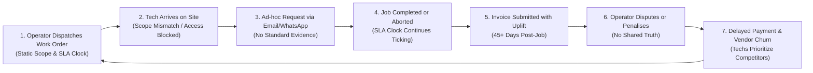
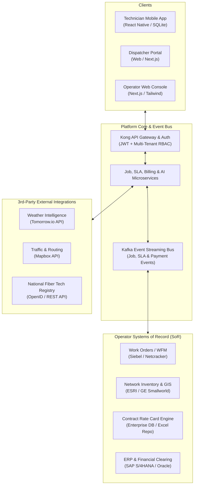
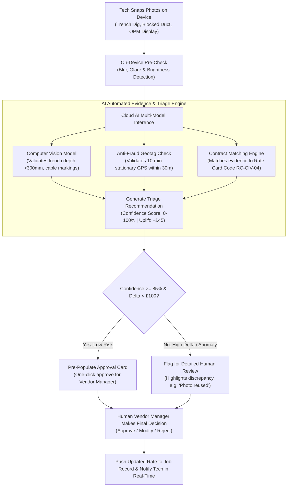
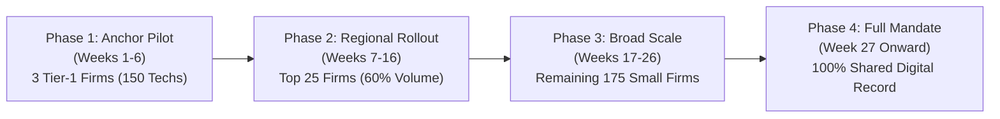
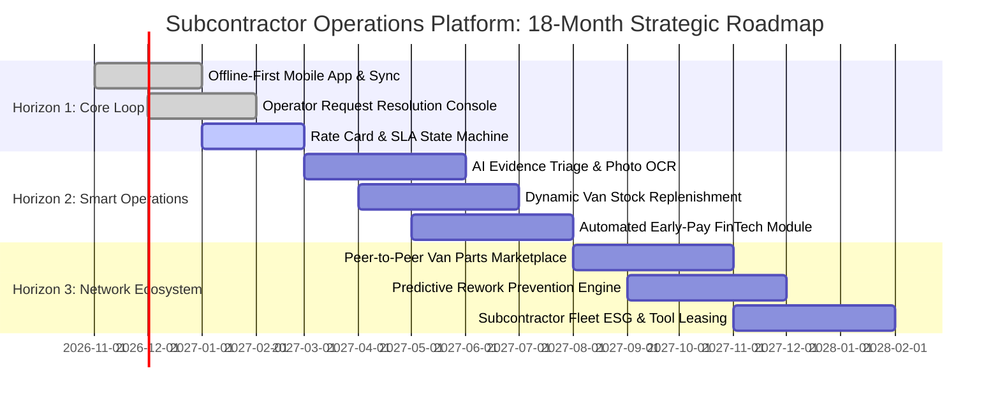

# Subcontractor Operations Platform — Complete Master Specification & Wireframe Blueprint

> **Enterprise Scope:** National Fiber Broadband Operator Rollout (~6,000 jobs/week across ~200 independent subcontractor firms)  
> **Author:** Komal Agarwal | B2B Product Management Deliverable  
> **Dual Surface Architecture:** Field Technician Mobile App (Offline-First Android 11+) & Operator Web Console (Next.js / Tailwind)  
> **Interactive Prototype:** Open [`wireframes.html`](./wireframes.html) to interact with live screens, triage queues, and the offline simulator.  
> **Presentation Alignment:** This document maps 1:1 with [`presentation_deck.pptx`](./presentation_deck.pptx) and [`presentation_deck.html`](./presentation_deck.html).

---

## 🧭 Executive Alignment Index: Slides to Wireframe Blueprint

| Presentation Slide | Document Section | Interactive Prototype Screen (`wireframes.html`) | Strategic Focus |
|---|---|---|---|
| **Slide 1** | [1. Executive Summary & The £50M Blind Spot](#1-executive-summary-the-50m-blind-spot) | Top Nav & Architecture Banner | Macro scale, 45-day lag, £1.07M net value |
| **Slide 2** | [2. Discovery & Incentive Alignment](#2-discovery--incentive-alignment-where-the-two-sides-collide) | Incentive Compact Sidebar | Rejection triggers & persona alignment |
| **Slide 3** | [3. Mobile App & Onboarding UX (Item 2.1)](#3-field-tech-mobile-app--zero-friction-onboarding-item-21) | Mobile Surface: Screens A, B, C, D | <120s budget, 6-step onboarding, offline SQLite |
| **Slide 4** | [4. Operator Console & 4-Hour SLA (Item 2.2)](#4-operator-performance-console--4-hour-decision-sla-item-22) | Console Surface: Scorecard & Adjudication | 4h countdown, scorecard, side-by-side diff |
| **Slide 5** | [5. System Architecture & Resilience (Item 2.3)](#5-api--system-architecture-operator-sor-3rd-party-item-23) | API Resiliency Matrix | Degraded modes, SFTP Day 1 batch mode |
| **Slide 6** | [6. AI Workflow Deep-Dive: Scope Triage (Item 2.4)](#6-ai-workflow-deep-dive-smart-evidence-verification--scope-triage-item-24) | Console: AI Triage Assistant Card | Computer vision, OCR, ethical boundaries |
| **Slide 7** | [7. Implementation Challenges & Mitigations (Item 2.5)](#7-implementation-challenges--enterprise-mitigations-item-25) | Design Principles Card & Security Specs | 24k photos/wk, WhatsApp inertia, multi-tenant |
| **Slide 8** | [8. Business Model & 2.86x ROI (Item 2.6)](#8-business-model-unit-economics--286x-operator-roi-item-26) | Economic Model Callout | 5–8% vendor margin, 100% free tier, £1.07M savings |
| **Slide 9** | [9. Go-To-Market Strategy (Item 2.7)](#9-go-to-market-gtm-strategy-scaling-to-200-firms-item-27) | Rollout Roadmap Tracker | 4-phase scale, carrot & stick balance |
| **Slide 10** | [10. Strategic Roadmap: Horizons 1–3 (Item 2.8)](#10-strategic-roadmap-horizons-1-2-and-3-item-28) | Strategic Horizons Matrix | Van stock, weather delay shield, parts marketplace |
| **Slide 11** | [11. Roleplays: COO Pitch & Scathing Critique](#11-live-interview-roleplays-coo-pitch--defensive-teardown) | Roleplay Reference Drawer | Verbatim pitch script & brutal self-critique |

---

## 1. Executive Summary: The £50M Blind Spot
*(Corresponds to Slide 1 of the Presentation Deck)*

A national fiber broadband operator delivering **~6,000 jobs per week** relies on **~200 independent subcontractor firms** for 70% of its field execution (residential FTTH installs, customer premise drops, network maintenance, and red Loss of Signal fault repairs). 

Today, this £50M+ annual operation runs through an operational black box between morning dispatch and month-end invoice.

### The Operational Friction Loop


### The Three Operational Realities
1. **Massive Field Scale (~6,000 Jobs/Week):** 70% delivered by 200 partner firms ranging from 3-person family outfits to 400-van commercial fleets.
2. **Payment & Dispute Lag (45–60 Days):** Variations travel over ad-hoc WhatsApp threads and unmonitored inboxes. Subcontractor firms run on 5% to 8% margins; arbitrary deductions threaten cash flow and cause technicians to abandon the operator's jobs for rival telcos.
3. **Net Value Opportunity (£1.07M/Year | 2.86x Net ROI):** By cutting unverified leakage, lifting first-time fix rates by 3 points (saving 9,360 second-truck rolls), and halving dispute administration, the operator captures £1.07M net annual value on a £374k platform ARR.

> [!IMPORTANT]
> **The Core Operational Shift:** Replace unverified end-of-month commercial warfare with a **real-time, offline-first shared source of truth** between the technician's van and the operator's console.

---

## 2. Discovery & Incentive Alignment: Where the Two Sides Collide
*(Corresponds to Slide 2 of the Presentation Deck)*

The platform succeeds only by eliminating the structural reasons each stakeholder would reject it.

```
+-------------------------------------------------------+-------------------------------------------------------+
| OPERATOR PERSPECTIVE (Priya Sharma & David Vance)     | SUBCONTRACTOR PERSPECTIVE (Imran, Meera & Ravi)       |
+-------------------------------------------------------+-------------------------------------------------------+
| • Priya Sharma (Regional Ops Manager - 1,500 jobs/wk) | • Imran Khan (Firm Owner - 25 vans, £150k monthly payroll)
| • David Vance (Vendor Commercial Manager - 200 firms) | • Meera (Dispatcher - 70 daily jobs via WhatsApp/Excel)
|                                                       | • Ravi Patel (Field Technician - 6 yrs piece-rate tech)
+-------------------------------------------------------+-------------------------------------------------------+
| Core Motivation:                                      | Core Motivation:                                      |
| High throughput, first-time fix rate, cost control    | Cash flow predictability, weekly payroll stability,   |
| against rate cards, defensible audit trails.          | protection against arbitrary deductions, zero app pain.|
+-------------------------------------------------------+-------------------------------------------------------+
| Current Pain Today:                                   | Current Pain Today:                                   |
| • Rate variations arrive as £95 surprises 4 wks late. | • Subcontractor net margin is 6%; arbitrary invoice   |
| • Unclear if 'access failure' was real or late tech.  |   clawbacks wipe out monthly profit.                  |
| • 2 full days monthly spent stitching CSV scorecards. | • Mobile app crashes in basements and loses photos.   |
+-------------------------------------------------------+-------------------------------------------------------+
| ❌ REJECTION TRIGGER:                                 | ❌ REJECTION TRIGGER:                                 |
| "If it requires manual data re-entry or doesn't tie   | "If you charge our 6% margin a SaaS fee, or if the    |
| directly to our dispatch pipeline, supervisors will   | app adds >2 minutes per job, we will shift our vans   |
| ignore it completely."                                | to your competitor's network."                       |
+-------------------------------------------------------+-------------------------------------------------------+
```

### The Incentive Compact: Resolving the Structural Tensions
- **Rate Variations:** Operator gets geotagged photo proof on-site  ←→  Subcontractor gets a binding 4-hour decision turnaround.
- **SLA Clock Pauses:** Operator prevents false access claims  ←→  Subcontractor auto-attaches GPS & timestamps to prove presence.
- **Platform Monetization:** Operator funds platform via leakage savings (£1.20/job)  ←→  Core platform is **100% FREE** for subcontractors.

---

## 3. Field Tech Mobile App & Zero-Friction Onboarding (Item 2.1)
*(Corresponds to Slide 3 of the Presentation Deck)*

Engineered specifically for dirty hands, heavy safety gloves, entry-level Androids (Android 11+), and zero cellular signal.

### The Three Field Usability Pillars
1. **6-Step Fast Onboarding (<3 Minutes):**
   - Step 1: SMS deep link sent by dispatcher ("Apex Fiber has assigned your van. Tap to setup.").
   - Step 2: Auto-reads 6-digit OTP; cryptographically binds phone to Ravi Patel @ Apex Fiber Ltd.
   - Step 3: Transparent, plain-English permissions (Camera for splice validation, Location for arrival proof).
   - Step 4: Autonomous offline pack download (12MB: North Region offline tiles, rate card terms, daily route).
   - Step 5: 45-second skippable interactive micro-tour (photo snap, SLA pause button, outbox badge).
   - Step 6: Live job queue ready.
2. **Offline-as-Default State:**
   - Every action writes instantly to local encrypted SQLite storage (0ms network blocking).
   - Actions queue with monotonically increasing sequence numbers and GPS UTC stamps.
   - On-device WebP compression converts 3MB camera captures to <200KB.
   - Background daemon syncs metadata JSON (<5KB) first, followed by chunked media.
3. **<120-Second Field Budget:**
   - 4-tap complete closeout workflow.
   - Zero mandatory free-text fields.
   - 48px+ touch targets for gloved fingers.
   - Prominent, always-visible live SLA countdown clock.

### Mobile Screen Wireframe Architecture

```
+-----------------------------------+  +-----------------------------------+  +-----------------------------------+
| TODAY'S JOBS        [Sync: 2 Queued]|  | JOB #8492 - INSTALL    [SLA: 1h 42m]|  | RAISE REQUEST         [Job #8492] |
+-----------------------------------+  +-----------------------------------+  +-----------------------------------+
| [!] OFFLINE MODE - Local Storage  |  | 142 Elmwood Ave, Springfield      |  | Select Reason:                   |
+-----------------------------------+  | Scope: Standard FTTH Drop (30m)   |  | (o) Rate Variation (Mis-scoped)   |
| [1] 08:30 - 10:30        [ACTIVE] |  | Rate Card: £120.00 (Line 104)     |  | ( ) SLA Pause (Site Inaccessible) |
| 142 Elmwood Ave - Install         |  +-----------------------------------+  | ( ) Customer No-Show              |
| SLA: 1h 42m remaining             |  | REQUIRED EVIDENCE (2 of 3 Done)   |  | ( ) Health & Safety Civils Block  |
+-----------------------------------+  | [X] Optical Power Meter (-18.2dB) |  +-----------------------------------+
| [2] 11:30 - 13:30       [QUEUED]  |  | [X] Splice Tray Photo             |  | Context Auto-Attached:            |
| 89 High St - Red LOS Fault        |  | [ ] Premise Entry Box Photo       |  | • GPS: 51.5074 N, 0.1278 W (On-site)
| Parts: Replacement ONT on van     |  +-----------------------------------+  | • Timestamp: 09:14:22 UTC         |
+-----------------------------------+  | [ > TAKE REMAINING PHOTO < ]      |  | • Current SLA: Pauses immediately |
| [3] 14:30 - 16:30       [QUEUED]  |  +-----------------------------------+  +-----------------------------------+
| 12 Mill Lane - Cable Replacement  |  | [ COMPLETE JOB (Ready to Sync) ]  |  | Evidence Required:                |
+-----------------------------------+  |                                   |  | [ CAMERA: Snap Obstruction ]      |
| [Jobs]   [Requests]   [Van Stock] |  | [ Raise Request / Pause Clock ]   |  | [ SUBMIT REQUEST (Offline Ready)] |
+-----------------------------------+  +-----------------------------------+  +-----------------------------------+
       Screen 1: Job List                   Screen 2: Evidence Capture               Screen 3: Request Drawer
```

### Guided Photographic Evidence Protocol
To permanently eliminate 45-day invoice arguments, job closeout requires 3 standardized photos:
- **Snap 1: Optical Power Meter (OPM):** On-device OCR reads the numeric attenuation (e.g., `-18.2 dBm`). Verifies within acceptable dBm limits before leaving premise.
- **Snap 2: Fusion Splice Tray:** Verifies neat fiber routing, splice protector sleeves, and zero micro-bends.
- **Snap 3: Customer Premise Entry / CSP Box:** Confirms weatherproof entry grommet and exterior cable demarcation.

---

## 4. Operator Performance Console & 4-Hour Decision SLA (Item 2.2)
*(Corresponds to Slide 4 of the Presentation Deck)*

The operator web console connects regional capacity monitoring with real-time commercial dispute triage.

```
+---------------------------------------------------------------------------------------------------------------+
| OPERATOR PERFORMANCE CONSOLE | Region: Northern | Active Jobs: 1,420 | Queue SLA: 88% on-time  | User: D. Vance|
+---------------------------------------------------------------------------------------------------------------+
| KPI OVERVIEW: Weekly Vol: 5,940/6,000 | SLA Hit: 91.4% | First-Time Fix: 87.2% | Avg Dispute Cycle: 1.4 Days  |
+-------------------------------------------------------+-------------------------------------------------------+
| FIRM SCORECARD (Live Benchmarking across 200 firms)   | INCOMING REQUEST RESOLUTION QUEUE (Active: 14)       |
| Firm Name         Active  SLA%   FTF%   Dispute% Flag | ID    Firm       Job Type   Request Type  Wait   Risk |
| ----------------------------------------------------- | ----------------------------------------------------- |
| Apex Fiber Ltd      42    94.2%  91.0%   2.1%   [OK]  | #491  Apex Fiber Install    Rate Var (+£45) 12m   LOW  |
| NorthConnect        28    88.5%  82.4%   8.4%   [WARN]| #494  QuickSplice Repair    SLA Pause     24m   MED  |
| QuickSplice Co      14    91.0%  86.1%   4.0%   [OK]  | #498  NorthConnect Install   Rate Var (+£80) 41m   HIGH |
| MetroTelcom (Sub)   65    79.2%  74.0%  14.2%   [CRIT]| (Decision Due in <4 Hours to avoid field stall)      |
+-------------------------------------------------------+-------------------------------------------------------+
| SELECTED CLAIM (ID #491 - Apex Fiber - Tech: Ravi Patel)                                                      |
| DISPATCHED SCOPE                CLAIMED VARIATION               AI TRIAGE ASSISTANT                           |
| Base: Standard FTTH Drop (£120) Extra 25m Soft Dig (+£45)       Confidence: 94% (Valid Claim)                 |
| Rate Card Line: 104             Proposed Line: 108              • Geotag confirms within 12m of premise       |
| Total Dispatched: £120.00       Total Claim: £165.00            • Trench photo depth verified (>300mm)        |
| EVIDENCE SUBMITTED: [Photo 1: Trench Dig] [Photo 2: Blocked Duct] [GPS/Timestamp Verified: 09:14:22 UTC]      |
|                                                                                                               |
| ACTION:  [ APPROVE VARIATION (£45) ]   [ COUNTER / MODIFY ]   [ REQUEST MORE INFO ]   [ REJECT (CODE) ]       |
+---------------------------------------------------------------------------------------------------------------+
```

### Core Console Capabilities
1. **Real-Time Cross-Firm Scorecard:** Evaluates all 200 firms on SLA Hit Rate, First-Time Fix % (30-day rework-free), and Dispute Rate %. Replaces 2 days of manual monthly analyst work.
2. **Binding 4-Hour Operator Decision SLA:** Unresolved claims change from Slate to Amber (at 2h) to Red (at 3.5h). If the operator stalls past 4 hours on a paused job, the platform **automatically credits the decision in the subcontractor's favor**.
3. **Side-by-Side Adjudication:** Dispatched contract scope and claimed uplift diff displayed alongside high-resolution field photos.
4. **Mandatory Reason-Coded Rejections:** Requires standard audit reason codes (`EVID-INSUFFICIENT`, `OUT-OF-SCOPE-PERMIT`, `STANDARD-INCLUSION`) to prevent arbitrary deductions.

---

## 5. API & System Architecture (Operator SoR & 3rd-Party) (Item 2.3)
*(Corresponds to Slide 5 of the Presentation Deck)*

A decoupled, event-driven integration architecture designed to survive legacy telco IT maintenance and edge network outages.



### API Data Flow & Degraded Resiliency Matrix
| Integration Endpoint | Source / Target | Direction | Mechanism | Data Payload | Degraded Mode (System Unavailable) |
|---|---|---|---|---|---|
| **Work Orders** | Operator WFM → Platform | **PULL / WEBHOOK** | Webhook + Daily Delta Batch | Work order ID, address, scope code, SLA clock. | **Circuit Breaker Active:** Serve cached jobs from Redis/PostgreSQL; queue status updates in Kafka. |
| **Network Inventory & GIS** | Operator GIS ↔ Platform | **PULL** | REST on Demand | DP location, duct availability, fiber allocations. | **Static Snapshot Fallback:** Pre-cached GIS snapshot used; flags pending verification. |
| **Rate Cards & Contracts** | Operator Contracts → Platform | **PULL** | Weekly Batch Sync | Contract line IDs, base prices, allowed variation codes. | **Stale-While-Revalidate:** Lock to last signed rate card; prevent live price distortion. |
| **Payment Events** | Platform → Operator ERP | **PUSH** | Asynchronous Webhook | Approved job ID, completion tokens, self-bill remittance. | **PostgreSQL Outbox Pattern:** Buffer payment events; retry with idempotency keys. |
| **Weather Intelligence** | Tomorrow.io → Platform | **PULL** | Hourly Polling | Winds >35mph, lightning alerts. | **Default to Permissive:** Auto-allow manual weather pause; flag for spot review. |
| **Traffic & Routing** | Mapbox → Platform | **PULL** | Real-time REST | Driving ETA, optimized routing. | **Haversine Math Fallback:** Local straight-line distance math on device. |
| **Tech Certifications** | Certification Registry → Platform | **PULL** | Nightly Sync | Working at Heights, Splicer L3 validity dates. | **Cached Grace Period:** 7-day grace period on cached status; warning banner. |

> [!TIP]
> **Enterprise Reality Check:** On Day 1, we ingest via **flat-file SFTP CSV batch drops** and export standard self-billing CSVs. We do not delay pilot rollout waiting 12 months for telco IT to build REST APIs.

---

## 6. AI Workflow Deep-Dive: Smart Evidence Verification & Scope Triage (Item 2.4)
*(Corresponds to Slide 6 of the Presentation Deck)*

### The Workflow: On-Site Rate Variation Resolution
When a technician encounters unexpected field conditions (e.g., collapsed civil duct requiring a 25m soft dig), they submit a variation request with photo proof.



### The Three Operational Pillars: Model vs. Human vs. Forbidden

```
+-----------------------------------+-----------------------------------+-----------------------------------+
| WHAT AI MODEL DECIDES             | WHAT HUMAN VENDOR MANAGER DECIDES | WHERE AI IS STRICTLY FORBIDDEN    |
+-----------------------------------+-----------------------------------+-----------------------------------+
| • Computer Vision & OCR:          | • Financial Approvals:            | • NO Automated Clawbacks:         |
|   - Reads -18.2 dBm on OPM screen |   - Reviews pre-populated diff    |   Machine financial deductions    |
|   - Trench depth >300mm validated |     card in <30 seconds           |   destroy supplier trust and      |
|   - Flags duplicate photos via    |   - Executes 100% of binding      |   trigger lawsuits.               |
|     perceptual hash matching      |     financial approval clicks     |                                   |
|                                   |                                   | • NO Algorithmic De-ranking:      |
| • Contract Mapping:               | • Edge Cases & Counter-Offers:    |   Banning vendor allocation based |
|   - Maps physical condition to    |   - Evaluates subjective ground   |   on black-box scoring breaches   |
|     contract code (RC-CIV-04)     |     conditions                    |   labor standards.                |
|   - Calculates +£45.00 delta      |   - Modifies proposed uplifts     |                                   |
|   - Generates confidence score    |   - Issues coded rejections       | • NO Auto-Rejection:              |
|                                   |                                   |   Low confidence routes to human  |
|                                   |                                   |   queue; never auto-rejected.     |
+-----------------------------------+-----------------------------------+-----------------------------------+
```

### AI Operational Target Metrics
- **Triage Latency Reduction:** Review time cut by 80% (<90 seconds per claim).
- **Human Override Rate:** Maintained at <15% (if overrides exceed 15% on any rate code, it is pulled for retraining).
- **Dispute Recurrence:** Drops to <2% post-implementation.

---

## 7. Implementation Challenges & Enterprise Mitigations (Item 2.5)
*(Corresponds to Slide 7 of the Presentation Deck)*

```
+---------------------------------------------------------------------------------------------------------------+
| 01 | TECHNICAL CHALLENGE: 24,000 Photos/Week over Congested Edge Networks                                      |
| • Reality: 6,000 jobs/wk × 4 photos = ~12GB media uploaded from rural lanes and basements with sub-1 Mbps uplink|
| • Architectural Mitigation:                                                                                   |
|   - On-device WebP progressive compression (<200KB per photo).                                                |
|   - Priority metadata JSON sync first (<5KB), followed by chunked background media upload queue.              |
|   - CRDT-based offline conflict resolution (physical field telemetry is immutable).                         |
+---------------------------------------------------------------------------------------------------------------+
| 02 | ADOPTION CHALLENGE: Dispatcher "WhatsApp Inertia" & Tech Surveillance Fears                             |
| • Reality: Dispatchers manage 70 jobs/day via WhatsApp; technicians view apps as operator surveillance tools. |
| • Behavioral Mitigation:                                                                                      |
|   - 1-click WhatsApp deep-link invite bridges during the first 30 days of onboarding.                         |
|   - Immediate technician value: offline premise wiring diagrams, automated customer calling, no evening forms.|
|   - Privacy-by-design: zero background GPS tracking; location polled only at arrival and closeout taps.       |
+---------------------------------------------------------------------------------------------------------------+
| 03 | COMMERCIAL CHALLENGE: Multi-Tenant Data Privacy Between Competitors                                      |
| • Reality: 200 subcontractor firms compete fiercely for regional work and contract for rival telcos.          |
| • Governance Mitigation:                                                                                      |
|   - Strict cryptographic tenant isolation.                                                                    |
|   - Firm A never sees Firm B's scorecards, capacity, or rate structures.                                     |
|   - Operator sees only work orders dispatched on their own network; third-party telco jobs are invisible.     |
+---------------------------------------------------------------------------------------------------------------+
```

---

## 8. Business Model, Unit Economics & 2.86x Operator ROI (Item 2.6)
*(Corresponds to Slide 8 of the Presentation Deck)*

### The Subcontractor Margin Dilemma
Subcontractors operate on razor-thin net profit margins between **5% and 8%**. They supply their own capital equipment (vans at £450/month, fusion splicers at £6,000+, OTDR testers at £4,000+).

> [!WARNING]
> **The Margin Law:** Charging a 2% SaaS fee to subcontractors wipes out 25% to 40% of their net profit. They will immediately redirect their certified crews to rival telecom networks. **The core platform is 100% FREE to subcontractors.**

### The Monetization Architecture
1. **Operator Enterprise SaaS Tier:**
   - **£1.20 per completed job**, funded entirely by the Operator.
   - At 6,000 jobs/week (312,000 jobs/year) = **£374,400 Annual Recurring Revenue (ARR)**.
2. **Subcontractor Fast-Pay FinTech Module (Optional):**
   - Standard terms: Operator settles approved jobs on Net-45 day terms (**Free for all subcontractors**).
   - Optional 48-hour accelerated settlement at 1.5% dynamic discount fee, underwritten by operator banking facility. Subcontractors eliminate overdraft debt; operator captures liquidity rebate.

### Operator Year-1 ROI Waterfall
```
1. Dispute & Rate Leakage Savings:     +£450,000 / Yr   (Disputes drop from 8% to 2% across 312k jobs)
2. First-Time Fix (FTF) Recovery:      +£795,600 / Yr   (FTF lifts 84% -> 87%; 9,360 avoided truck rolls @ £85)
3. Vendor Management Admin Overhead:   +£200,000 / Yr   (4 FTEs redeployed from spreadsheet audits)
------------------------------------------------------
GROSS ANNUAL VALUE CREATED:            +£1,445,600 / Yr
LESS PLATFORM COST (£1.20/job):         (£374,400) / Yr
------------------------------------------------------
NET ANNUAL OPERATOR SAVINGS:           +£1,071,200 / Yr  (2.86x ROI | Payback in < 5 Months)
```

---

## 9. Go-To-Market (GTM) Strategy: Scaling to 200 Firms (Item 2.7)
*(Corresponds to Slide 9 of the Presentation Deck)*

A 4-phase, 26-week rollout balancing operational incentives (carrots) with billing compliance (sticks).



### Rollout Phases
- **Phase 1: Anchor Pilot (Weeks 1–6):** 3 friendly Tier-1 firms (~150 techs, 1,000 jobs/wk) in Northern region. Validates offline sync and <2 min friction budget. **Carrot: Guaranteed Net-7 payment settlement.**
- **Phase 2: Top 25 Regional Expansion (Weeks 7–16):** Onboards the top 25 firms delivering ~60% of total weekly volume. Half-day train-the-dispatcher workshops; dispatcher web portal live.
- **Phase 3: Long-Tail Onboarding (Weeks 17–26):** Remaining 175 small outfits (3–15 techs). Low-touch self-serve onboarding via SMS deep link and 3-min video guides.
- **Phase 4: Shared Record Mandate (Week 27+):** Operator updates billing policy: unverified paper invoices face 60-day manual audit queues; platform-verified invoices bypass manual audit to pay in 7 days.

---

## 10. Strategic Roadmap: Horizons 1, 2, and 3 (Item 2.8)
*(Corresponds to Slide 10 of the Presentation Deck)*



- **Horizon 1 (Months 1–3) — Digitize the Core Loop:** Offline-first mobile app, 4-hour decision console, rate card engine, SFTP flat-file batch ingestion.
- **Horizon 2 (Months 4–9) — Smart Field Operations:** AI evidence verification, predictive van stock replenishment via distributor APIs (Graybar, Rexel), and automated weather delay shields (>35mph wind mass SLA pause).
- **Horizon 3 (Months 10–18) — Network Ecosystem:** Peer-to-peer van parts exchange between non-competing field crews via QR scan, predictive rework prevention, and collective buying consortium for van leasing and fuel cards.

---

## 11. Live Interview Roleplays: COO Pitch & Defensive Teardown
*(Corresponds to Slide 11 of the Presentation Deck)*

### 11.1 The 5-Minute Executive COO Pitch Script (Task 3)

> **"Good morning. Thank you for your time.**
> 
> Let's look at the reality of your network today. You deliver 6,000 fiber jobs every week. 70% of those customer appointments—4,200 homes and businesses—depend entirely on third-party subcontractor crews. 
> 
> Right now, you are running that £50 million field operation through a blind spot.
> 
> Your systems see a work order dispatched at 8:00 AM, and they see an invoice arrive 45 days later. What happens in between is a complete black box. When a technician finds a collapsed duct or a customer no-show, that request travels over WhatsApp, phone calls, and unmonitored inboxes. The result? Your SLA clock keeps ticking, jobs fail, and your regional managers spend their weeks arbitrating angry disputes over who is to blame.
> 
> Even worse: because payment is slow and deductions feel arbitrary, your 200 subcontractor firms are actively pulling their best, highest-certified technicians off your territory and reassigning them to your direct competitors who pay faster.
> 
> We have built the **Subcontractor Operations Platform** to solve this exact friction loop.
> 
> We are not asking you to rip and replace your Salesforce, Netcracker, or SAP systems. We sit cleanly as the operational bridge between your systems of record and the technician's van.
> 
> Here is what changes on Day 1:
> 
> **First: Every job has one shared, unarguable record of truth.**  
> Technicians use an ultra-simple, offline-first mobile app designed for dirty hands and zero signal. In less than 90 seconds per job, they capture geotagged, time-stamped proof of splices and optical power levels. If there's an obstruction, they tap one button: the SLA clock pauses, the evidence is logged, and both sides see the exact same reality.
> 
> **Second: Variations become structured, same-day decisions instead of 6-month invoice battles.**  
> When a job requires extra work, your vendor managers review the evidence side-by-side with your contract rate card. Our AI triage assistant verifies the photos, checks GPS coordinates, and pre-populates the exact rate delta. Your manager clicks 'Approve' in under 30 seconds. No surprises on the month-end invoice.
> 
> **Third: You secure your labor supply in a fiercely competitive market.**  
> By verifying evidence upfront, you can guarantee your subcontractors settlement in 7 to 14 days rather than 45 to 60 days—without taking on financial risk. When subcontractors know they get paid predictably on your network, you become their customer of choice. You get their best crews, your first-time fix rate climbs, and your churn drops.
> 
> **The Economics:**  
> This platform costs £1.20 per completed job. Across your 312,000 annual jobs, that is an investment of £374,000.  
> In return, our conservative model recovers **£1.07 million in net annual savings**:
> - We eliminate £450,000 in unverified rate leakage and dispute overhead.
> - We recover £795,000 in avoided second-truck rolls by lifting your first-time fix rate by just 3 percentage points.
> 
> That is an immediate **2.86x ROI** in year one alone.
> 
> We are ready to launch a 6-week pilot in your Northern Region with 3 of your key firms, covering 150 technicians. We will prove offline reliability, evidence completeness, and dispute reduction before you roll it out nationally.
> 
> Let's turn your subcontractor network from your biggest operational headache into your strongest competitive advantage. Let's get the pilot started."

---

### 11.2 Scathing Self-Critique & Defensive Teardown (Task 4)

```
+---------------------------------------------------------------------------------------------------------------+
| CRITIQUE 1: The "Garbage In, Digital Garbage Out" Evidence Illusion                                          |
| "Techs running late will snap photos of random closed wooden gates from their vans to pause SLA clocks."      |
|                                                                                                               |
| 🛡️ THE DEFENSIVE COUNTERMEASURE: TRIPLE-VECTOR TELEMETRY BINDING                                              |
| 1. Hardware Camera EXIF: Blocks gallery photo re-uploads.                                                     |
| 2. 10-Minute Stationary GPS Breadcrumb: Confirms handset was within 30m boundary prior to access claim.       |
| 3. Optical Power Meter OCR: Automated optical loss threshold check (-14 to -24 dBm).                         |
| 4. Outlier Clustering: Flags statistical anomalies (e.g. "Tech X claims 4x more access issues on Fridays").   |
+---------------------------------------------------------------------------------------------------------------+
| CRITIQUE 2: The Enterprise Telco Integration Graveyard                                                        |
| "National telco IT takes 12 months just to open firewall ports; pilot will die in integration purgatory."     |
|                                                                                                               |
| 🛡️ THE DEFENSIVE COUNTERMEASURE: DECOUPLED ASYNCHRONOUS SFTP BATCH ARCHITECTURE                               |
| • Day 1 Ingestion: Operates via scheduled SFTP flat-file / CSV batch drops of work orders and rate cards.     |
| • Day 1 Output: Produces standard self-billing CSV remittance advice that drops into ERP AP queues.          |
| • Zero dependency on real-time synchronous SOAP/REST APIs for pilot go-live.                                 |
+---------------------------------------------------------------------------------------------------------------+
| CRITIQUE 3: The Subcontractor Principal-Agent Trap & Surveillance Backlash                                   |
| "Techs will strike or sabotage GPS over an 'electronic ankle monitor' tracking their every move."             |
|                                                                                                               |
| 🛡️ THE DEFENSIVE COUNTERMEASURE: PRIVACY-BY-DESIGN & BI-DIRECTIONAL TRANSPARENCY                               |
| • Zero Continuous Background GPS: Location polled strictly as an ephemeral event validation on action taps.  |
| • Bi-Directional Scorecards: Subcontractors track operator performance (Operator Decision SLA & Payment SLA).|
| • If operator takes >4 hours to adjudicate, job is automatically credited in subcontractor's favor.          |
+---------------------------------------------------------------------------------------------------------------+
| CRITIQUE 4: The Vendor Manager Queue Bottleneck                                                               |
| "200 variation requests/day will flood vendor managers, breaching the 4h SLA or causing blind rubber-stamps."  |
|                                                                                                               |
| 🛡️ THE DEFENSIVE COUNTERMEASURE: TIERED ALGORITHMIC AUTO-CLEARANCE                                            |
| • Tier 1 (Micro-Variations <£25 with >95% AI confidence & verified GPS): Auto-approved with 10% spot audit.   |
| • Tier 2 (Standard £25–£100): Pre-populated diff cards cut human decision time to <30 seconds.               |
| • Tier 3 (High-Value >£100 / Anomalies): Mandatory dual-authorization.                                        |
| • Active human queue drops from 200/day to fewer than 35 critical decisions per day.                          |
+---------------------------------------------------------------------------------------------------------------+
```

---

## 12. Design System & Touch Usability Tokens

| Design Element | Specification | Field Usability Rationale |
|---|---|---|
| **Primary Touch Target** | 48px height × 100% card width | Usable with safety work gloves and dirty hands. |
| **Typography Base** | 16px body; 20px+ key numbers | Readable in direct sunlight on entry-level Android LCDs. |
| **Primary Interactive Accent** | `#2563EB` (Blue 600) | Recognizable operational trigger color. |
| **Approved / Success** | `#059669` (Emerald 600) | Clear financial and operational clearance. |
| **SLA Warning Badge** | `#D97706` (Amber 600) | High visibility timer warnings (<45m and <15m). |
| **Critical / Blocker** | `#E11D48` (Rose 600) | Immediate visual indication of SLA pause or dispute. |
| **Background (Mobile)** | `#F8FAFC` (Slate 50) / `#0F172A` (Dark) | Glare reduction in variable lighting conditions. |
| **Interactive Prototype** | `wireframes.html` | Zero-dependency, modern responsive layout. |

---
*End of Master Specification & Wireframe Blueprint | Author: Komal Agarwal | Zinier B2B Product Management Deliverable*
