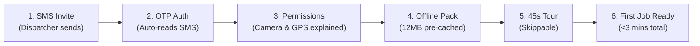
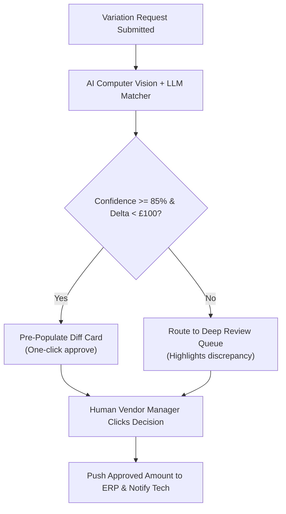

# Subcontractor Operations Platform — Wireframe & UX Architecture Specifications

> **System Scope:** National Fiber Broadband Operator Rollout (~6,000 jobs/week across ~200 independent subcontractor firms)  
> **Target Surfaces:** Field Technician Mobile App (Android 11+, Offline-First) & Operator Web Console (Next.js / Tailwind)  
> **Interactive Prototype:** Open [`wireframes.html`](./wireframes.html) in any modern browser to test live interactions, offline mode simulation, and triage queues.

---

## Table of Contents
1. [Design Philosophy & Field Constraints](#1-design-philosophy--field-constraints)
2. [Surface 1: Field Technician Mobile App](#2-surface-1-field-technician-mobile-app)
   - [2.1 Six-Step Zero-Friction Onboarding](#21-six-step-zero-friction-onboarding)
   - [2.2 Daily Job Queue (Offline-First)](#22-daily-job-queue-offline-first)
   - [2.3 Guided Photographic Evidence Capture](#23-guided-photographic-evidence-capture)
   - [2.4 Scope Mismatch & SLA Pause Drawer](#24-scope-mismatch--sla-pause-drawer)
   - [2.5 Offline Outbox State Machine & Edge Sync Protocol](#25-offline-outbox-state-machine--edge-sync-protocol)
3. [Surface 2: Operator Web Console](#3-surface-2-operator-web-console)
   - [3.1 Executive Regional KPI Bar](#31-executive-regional-kpi-bar)
   - [3.2 Cross-Firm Performance Scorecard](#32-cross-firm-performance-scorecard)
   - [3.3 Side-by-Side Adjudication Queue](#33-side-by-side-adjudication-queue)
   - [3.4 AI Triage Assistant & Decision SLA Lifecycle](#34-ai-triage-assistant--decision-sla-lifecycle)
4. [Design System & Usability Tokens](#4-design-system--usability-tokens)

---

## 1. Design Philosophy & Field Constraints

Field technicians operate in physically hostile environments:
- **Environment:** Rain, basements, utility poles, direct sunlight, muddy trenches.
- **Physical Wear:** Heavy safety gloves, smudged smartphone screens, single-handed operation.
- **Hardware Fleet:** Predominantly low-to-mid tier Android handsets (Android 11+) with constrained storage and battery.
- **Connectivity:** Intermittent or zero cellular signal in rural verges and multi-dwelling unit (MDU) basements.
- **Behavioral Incentive:** Paid piece-rate per completed job. **Any app adding >2 minutes of friction will be sabotaged or abandoned.**

### The Three Field Design Rules
1. **<120-Second Budget:** 4 taps maximum to close out a standard install. Zero mandatory free-text entry.
2. **Offline-as-Default:** Every UI action commits instantly to local encrypted SQLite storage. The UI **never** shows a blocking network spinner.
3. **Ergonomic Safety:** Minimum 48px touch targets, bottom-heavy thumb reach zones, high-contrast text ratios (>4.5:1).

---

## 2. Surface 1: Field Technician Mobile App

```
+-----------------------------------+  +-----------------------------------+  +-----------------------------------+
| TODAY'S JOBS       [Outbox: 2 Q'd]|  | JOB #8492 - INSTALL [SLA: 1h 42m] |  | RAISE REQUEST         [Job #8492] |
+-----------------------------------+  +-----------------------------------+  +-----------------------------------+
| [!] OFFLINE MODE - Local Storage  |  | 142 Elmwood Ave, Springfield      |  | Reason:                           |
+-----------------------------------+  | Scope: Standard FTTH Drop (30m)   |  | (o) Rate Variation (Mis-scoped)   |
| [1] 08:30 - 10:30        [ACTIVE] |  | Contract Rate: £120.00 (Line 104) |  | ( ) SLA Pause (Access Blocked)    |
| 142 Elmwood Ave - Install         |  +-----------------------------------+  | ( ) Customer No-Show              |
| SLA: 1h 42m remaining             |  | EVIDENCE CHECKLIST (2 of 3 Done)  |  | ( ) Health & Safety Civils Block  |
+-----------------------------------+  | [X] Optical Power Meter (-18.2dB) |  +-----------------------------------+
| [2] 11:30 - 13:30       [QUEUED]  |  | [X] Splice Tray Enclosure Photo   |  | Telemetry Attached Automatically: |
| 89 High St - Red LOS Fault        |  | [ ] Premise Entry / CSP Box Photo |  | • GPS: 51.5074 N, 0.1278 W        |
| Parts: Replacement ONT on van     |  +-----------------------------------+  | • Timestamp: 09:14:22 UTC         |
+-----------------------------------+  | [ > TAKE REMAINING PHOTO < ]      |  | • SLA Clock: Pauses at submit     |
| [3] 14:30 - 16:30       [QUEUED]  |  +-----------------------------------+  +-----------------------------------+
| 12 Mill Lane - Cable Replacement  |  | [ COMPLETE JOB (Ready to Sync) ]  |  | Evidence Capture:                 |
+-----------------------------------+  |                                   |  | [ CAMERA: Snap Obstruction ]      |
| [Jobs]   [Requests]   [Van Stock] |  | [ Raise Request / Pause Clock ]   |  | [ SUBMIT REQUEST (Offline Ready)] |
+-----------------------------------+  +-----------------------------------+  +-----------------------------------+
       Screen 1: Job List                   Screen 2: Evidence Capture               Screen 3: Request Drawer
```

### 2.1 Six-Step Zero-Friction Onboarding



1. **Dispatcher Triggers SMS Invite:** Subcontractor dispatcher registers Ravi Patel's phone number in their web console; an SMS with a one-time cryptographic install/auth token arrives.
2. **Frictionless Phone Verification (OTP):** The app auto-reads the SMS code; no email or password creation required. Handset is bound to Apex Fiber Ltd.
3. **Plain-English Permissions:** Explains *why* permissions are required:
   - *Camera:* Splicing validation and optical meter evidence.
   - *Location:* Proof of arrival so the operator cannot falsely claim a technician missed the appointment window.
4. **Autonomous Offline Pack Download:** The app downloads 12MB containing the regional offline tile cache, active rate card line descriptions, and daily job dispatches.
5. **45-Second Interactive Micro-Tour:** Illustrates photo capture, SLA timer visibility, and offline outbox behavior. Can be dismissed with 1 tap.
6. **Live Job Queue Ready:** Technicians can immediately start traveling to Job 1. Total elapsed setup time: **<180 seconds**.

---

### 2.2 Daily Job Queue (Offline-First)

- **Top Status Header:** Current time, cellular mode badge (`4G LTE` or `OFFLINE - 2 in outbox`), and battery level.
- **Van Stock Indicator:** Displays pre-requisite parts on vehicle (e.g., `Van: 2 ONTs, 300m Drop Cable, 4 Patch Cords`).
- **Active Job Card:**
  - High-visibility blue accent border.
  - Live SLA Countdown clock (e.g., `SLA: 1h 42m remaining`). Turns amber at <45 mins, red at <15 mins.
  - Address, premise contact, and dispatched job scope summary.
  - Single-tap route navigation via local maps.
- **Queued Job Cards:** Chronological queue for the day with scheduled arrival windows and prerequisite parts checklist.

---

### 2.3 Guided Photographic Evidence Capture

To eliminate 45-day invoice arguments, closeout requires 3 standardized, geotagged photos:

| Step | Photo Subject | Automated Verification Checks |
|---|---|---|
| **Photo 1** | **Optical Power Meter (OPM)** | On-device OCR reads the numeric optical power (e.g., `-18.2 dBm`). Verifies within acceptable attenuation limits (`-14 dBm` to `-24 dBm`). |
| **Photo 2** | **Fusion Splice Tray** | Computer vision checks clarity and confirms splice tube alignment and heat shrink integrity. |
| **Photo 3** | **Premise Customer Splice Point (CSP)** | Validates external drop cable entry neatness, weatherproof grommet, and premise demarcation. |

- **Edge Image Optimization:** Photos are compressed to progressive WebP format on the device (<200 KB per photo). Blur and glare checks occur immediately before saving so the tech can retake in 3 seconds rather than being flagged 2 weeks later.

---

### 2.4 Scope Mismatch & SLA Pause Drawer

When ground conditions do not match dispatched scope, the technician taps **"Raise Request / Pause Clock"**:
1. **Reason Selection (Radio Pills):**
   - `Rate Card Variation (Mis-scoped / Civil Block)`
   - `SLA Pause (Site Inaccessible / Gated)`
   - `Customer No-Show (Post-15 min wait)`
   - `Health & Safety / Permitting Block`
2. **Automated Context Attachment:**
   - Van GPS coordinates (validates proximity within 30m of premise).
   - Timestamp (UTC).
   - Current SLA remaining clock (pauses automatically upon submission).
3. **Single Evidence Photo:** Snaps the physical obstacle (e.g., collapsed civil duct or locked gate).
4. **1-Tap Offline Queue:** Enters SQLite outbox with monotonic sequence number. Tech is freed to move to next task or await manager response.

---

### 2.5 Offline Outbox State Machine & Edge Sync Protocol

```mermaid
stateDiagram-v2
    [*] --> LocalDraft
    LocalDraft --> EncryptedSQLiteOutbox: Tech submits action (0ms network wait)
    EncryptedSQLiteOutbox --> PendingNetwork: Tagged with UUID, Monotonic Seq, GPS UTC
    PendingNetwork --> NetworkDetected: Network listener fires
    NetworkDetected --> SyncMetadata: Push JSON delta payload (<5KB)
    SyncMetadata --> SyncMedia: Push WebP compressed photos (<200KB)
    SyncMedia --> ServerAcknowledged: Server returns 200 OK + Ledger ID
    ServerAcknowledged --> [*]: Removed from Outbox; Badge updates
```



- **Conflict Policy:** Field physical telemetry (timestamps, photos, GPS points) is **immutable**. The server never overwrites physical field timestamps. If a job was recalled by dispatch while the technician was offline, the app marks the job "Aborted Post-Dispatch" and automatically generates an aborted truck roll travel fee voucher (£45) to ensure the technician is paid for their travel.

---

## 3. Surface 2: Operator Web Console

```
+---------------------------------------------------------------------------------------------------------------+
| OPERATOR PERFORMANCE CONSOLE | Region: Northern | Active Jobs: 1,420 | Queue SLA: 88% on-time  | User: D. Vance|
+---------------------------------------------------------------------------------------------------------------+
| KPI OVERVIEW: Weekly Vol: 5,940/6,000 | SLA Hit: 91.4% | First-Time Fix: 87.2% | Avg Dispute Cycle: 1.4 Days  |
+-------------------------------------------------------+-------------------------------------------------------+
| SUBCONTRACTOR BENCHMARKING SCORECARD                  | INCOMING DISPUTE & VARIATION QUEUE (14 Pending)       |
| Firm Name         Active  SLA%   FTF%   Dispute% Flag | Ticket  Firm         Type          Wait   SLA    Risk |
| ----------------------------------------------------- | ----------------------------------------------------- |
| Apex Fiber Ltd      42    94.2%  91.0%   2.1%   [OK]  | #491    Apex Fiber   Rate Var (+£45) 12m   3h48m  LOW  |
| NorthConnect        28    88.5%  82.4%   8.4%   [WARN]| #494    QuickSplice  SLA Pause     24m   3h36m  MED  |
| QuickSplice Co      14    91.0%  86.1%   4.0%   [OK]  | #498    NorthConnect Rate Var (+£80) 41m   3h19m  HIGH |
| MetroTelcom (Sub)   65    79.2%  74.0%  14.2%   [CRIT]| (Decision Due in <4 Hours to avoid field stall)      |
+-------------------------------------------------------+-------------------------------------------------------+
| SELECTED CLAIM DETAIL: Ticket #491 — Apex Fiber Ltd (Tech: Ravi Patel)                                        |
| DISPATCHED CONTRACT SCOPE       CLAIMED RATE VARIATION          AI TRIAGE ASSISTANT (Confidence: 94%)         |
| Code: RC-FTTH-01 (Standard)     Code: RC-CIV-04 (Soft Dig 25m)  • GPS confirmed: 12m from customer premise     |
| Base Dispatched: £120.00        Claimed Uplift: +£45.00         • Photo analysis: 320mm trench depth confirmed|
| Target Window: 08:30 - 10:30    Total Self-Bill: £165.00        • Duplicate check: No prior matches found     |
| ------------------------------------------------------------------------------------------------------------- |
| EVIDENCE ATTACHED: [Photo 1: Trench Dig Depth] [Photo 2: Blocked Duct] [OPM Reading: -18.2 dBm]                |
|                                                                                                               |
| ACTIONS:  [ APPROVE VARIATION (£45) ]   [ COUNTER / MODIFY ]   [ REQUEST MORE INFO ]   [ REJECT (CODE) ]      |
+---------------------------------------------------------------------------------------------------------------+
```

### 3.1 Executive Regional KPI Bar
- **Weekly Volume Tracking:** Real-time counter of dispatched vs completed vs in-flight installations.
- **SLA Hit Rate:** Live percentage across all regional territories.
- **First-Time Fix (FTF) Rate:** Measures jobs with zero rework within 30 days.
- **Dispute Resolution Velocity:** Measures the time from variation submission to commercial approval (dropped from 45 days to 1.4 days).

---

### 3.2 Cross-Firm Performance Scorecard
Allows regional managers (Priya Sharma) and vendor managers (David Vance) to evaluate partner firms objectively:
- **Metrics Tracked:** Volume, SLA Hit %, First-Time Fix %, Rate Variation Request Rate %, and Rejection Rate.
- **Performance Tiers:**
  - `Tier 1 (Preferred / >92% SLA, >90% FTF):` Priority daily job allocation; eligible for fast-pay liquidity rebate.
  - `Tier 2 (Standard / 85–92% SLA):` Standard allocation.
  - `Tier 3 (Under Watch / <85% SLA or >10% Dispute Rate):` Automated warning; mandatory quality review on photo submissions.

---

### 3.3 Side-by-Side Adjudication Queue
Vendor managers adjudicate claims without opening separate tabs or legacy spreadsheets:
1. **Left Panel — Dispatched Contract Scope:** Original work order code, address, GIS duct assignment, scheduled rate card line item.
2. **Center Panel — Requested Variation:** Technician's claimed uplift, rate card line code diff, net monetary change.
3. **Right Panel — Evidence & Anti-Fraud Inspection:**
   - Raw high-resolution field photos with optical zoom and metadata overlay.
   - GPS premise geofence verification (confirms handset was within boundary for required duration).
   - OPM reading validation.

---

### 3.4 AI Triage Assistant & Decision SLA Lifecycle



- **Strict 4-Hour Decision SLA:** Unresolved claims change from Slate to Amber (at 2 hours) to Red (at 3.5 hours). If an operator allows the 4-hour clock to expire on a paused job, the platform automatically credits the pause in the subcontractor's favor, ensuring technicians are never left stranded on site without pay.
- **Standardized Rejection Reason Codes:** Eliminates arbitrary deductions:
  - `EVID-INSUFFICIENT` — Photo unclear or OPM reading missing.
  - `OUT-OF-SCOPE-PERMIT` — Requires council civils permit before trenching.
  - `STANDARD-INCLUSION` — Requested work already covered by base line item.

---

## 4. Design System & Usability Tokens

| Element | Specification | Rationale |
|---|---|---|
| **Primary Action Touch Target** | Minimum 48px height × 100% card width | Usable with safety work gloves and dirty hands. |
| **Typography Base** | 16px font-size for body; 20px+ for critical numbers | High legibility in direct sunlight on entry-level Android LCDs. |
| **Color: Primary Accent** | `#2563EB` (Blue 600) | Recognizable operational interactive trigger. |
| **Color: Approved / Success** | `#059669` (Emerald 600) | Unambiguous completion and financial clearance. |
| **Color: SLA Warning** | `#D97706` (Amber 600) | High visibility timer warnings at 45m and 15m. |
| **Color: Urgent / Critical** | `#E11D48` (Rose 600) | Immediate blocker or critical SLA breach. |
| **Background (Mobile)** | `#F8FAFC` (Slate 50) / `#0F172A` (Dark) | Clean contrast against field glare. |
| **Interactive Prototype** | `wireframes.html` | Zero-dependency, modern responsive layout. |

---
*End of Wireframe & UX Architecture Specification.*
